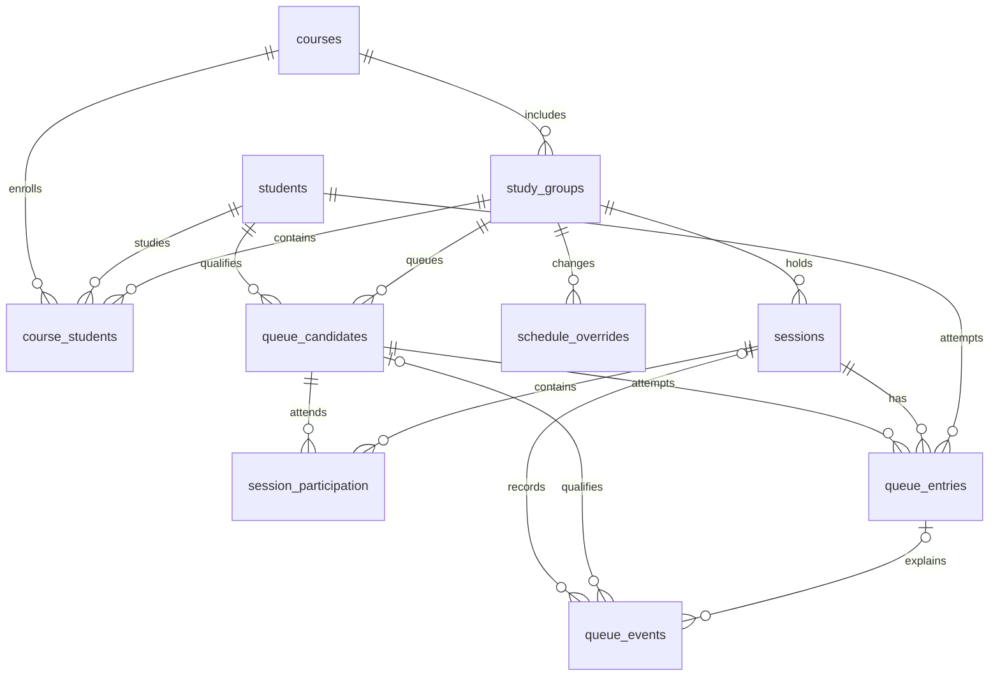

[Главная](../../README.md) · [Навигация по документации](../README.md)

# ADR-0002. Состояние очереди и история в SQLite

В SQLite хранятся участники постоянной очереди, занятия, намерения посещения, попытки и события на постоянном локальном диске. Каждое действие меняет запись и добавляет событие одной транзакцией. Это сохраняет очередь при перезапуске и позволяет объяснить её состояние без отдельного серверного сервиса БД.

## Контекст и границы

Очередь должна переживать перезапуск процесса и обновление приложения. Несколько обновлений допуска и намерений посещения могут прийти одновременно, а преподаватель может открыть страницу в двух вкладках. Одного списка в памяти недостаточно: теряются ожидающие, результаты и защита от дублей.

Курсов, групп и занятий несколько. Их время может пересекаться. Имя студента не уникально, GitHub может быть ещё не сопоставлен, а строка в Google Sheets может переместиться. История должна содержать отдельные попытки, а не только последнее состояние студента.

Встроенная БД допускается предоставленными разъяснениями задания при обосновании усложнения. SQLite не требует отдельного сетевого сервиса. Все записи относятся к организации защит; оценки остаются в существующих таблицах и не обновляются этим модулем.

## Рассмотренные варианты

| Вариант | Сохранность | Конкурентные изменения | Цена для проекта | Вывод |
|---|---|---|---|---|
| Список в памяти | Теряется при остановке | Нужны блокировки, между процессами состояние расходится | Минимум для демонстрации | Не удовлетворяет хранению истории |
| JSON на диске | Возможна при корректной атомарной замене | Требуются отдельные блокировки и защита от потерянных обновлений | Растёт с появлением истории и ограничений | Прост только до появления нескольких писателей |
| Google Sheets как очередь | Внешнее постоянное хранение | Нет общей транзакции со своим состоянием и привычных SQL-ограничений | API-запросы, лимиты, сеть, риск задеть оценки | Источник допуска, без записи состояния очереди |
| SQLite | Локальные транзакции и ограничения | Один писатель; короткие операции сериализуются | `sqlite3` в стандартной библиотеке, один файл и миграции | Выбрано |
| PostgreSQL | Серверные транзакции и больше возможностей параллельной записи | Подходит для нескольких хостов | Отдельное развёртывание и эксплуатация | Избыточно для текущего масштаба и ограничения внешних сервисов |

SQLite подходит для приложения на одном хосте с умеренным числом коротких записей; документация отдельно рассматривает такой тип применения. Это соответствие предполагаемой нагрузке, а не проведённый нагрузочный тест. [SQLite: Appropriate Uses](https://sqlite.org/whentouse.html).

## Решение и структура

Полная DDL находится в [schema.sql](../hackathon/suaios/queue/schema.sql), пояснения полей и операции в [структуре БД](../hackathon/suaios/queue/README.md). Файл служит снимком схемы после миграции 008. Приложение применяет версионированные миграции автоматически, а тест сравнивает их результат со снимком.

| Таблица | Назначение |
|---|---|
| `courses` | Стабильный `course_id`, часовой пояс, выбранный вуз и режим расписания |
| `study_groups` | Группы внутри курса; одинаковое обозначение группы на разных курсах не смешивает данные |
| `students` | Внутренний идентификатор, ФИО и необязательный GitHub. ФИО не является ключом |
| `course_students` | Актуальное соответствие студента курсу, группе и стабильному ключу строки источника |
| `schedule_overrides` | Ручная отмена, перенос или добавление занятия; автор и ревизия изменения |
| `sessions` | Конкретное занятие/дневная сессия, временные границы и назначенный преподаватель |
| `queue_members` | Полный состав группы, целевая работа, предварительный срок и признак завершения; включает студентов без готовой работы |
| `session_roster` | Случайный ключ и порядок студента на занятии; регистрация работы не запускает новую жеребьёвку |
| `queue_candidates` | Постоянный участник очереди с первой доступной допущенной работой после последней защищённой, сроком и временем допуска |
| `session_participation` | Намерение прийти на конкретное занятие и момент фиксации состава |
| `queue_entries` | Одна попытка защиты одной работы: состояние, приоритет, время и снимок данных для истории |
| `queue_events` | Неизменяемая история записи и занятия с автором действия |

Двух таблиц «студент + очередь» не хватает для нескольких попыток одного человека и нескольких занятий одной группы. Если записать результат и время прямо в строку студента, новая защита перезапишет предыдущую. Если хранить один общий список, пересекающиеся пары смешаются. Отдельная таблица `queues` не требуется: постоянные участники определяются курсом и группой, а состав приёма — занятием.

Копия всех курсовых оценок и отдельный реестр лабораторных не создаются. `lab_key` и `lab_order` проверяются по конфигурации курса. `eligibility_snapshot` хранит прочитанное обозначение допуска и время чтения для объяснения решения; это не новая оценка. Снимки ФИО и GitHub сохраняют вид истории при последующем исправлении профиля. Стабильный ключ источника нельзя подменять номером строки Sheets. При отсутствии однозначного сопоставления записываться от имени первого совпавшего ФИО нельзя: интерфейс должен запросить уточнение по существующему контексту группы/GitHub.

Курс и студенты не удаляются каскадом вместе с историей. Перевод в другую группу меняет текущее членство, старые записи сохраняют свою группу и снимки. Записи не ссылаются на изменяемое членство через составной FK; его актуальность проверяется при новой записи, а принадлежность записи занятию закреплена составным внешним ключом.

## Целостность и одновременные запросы

На каждом соединении используются `foreign_keys=ON`, `busy_timeout=5000`, `synchronous=FULL`. Для базы на локальном постоянном диске выбран `journal_mode=WAL`: читатели могут работать параллельно с писателем, но одновременно писать всё ещё может один процесс. Сетевой том для общего WAL между хостами не подходит. [SQLite WAL](https://sqlite.org/wal.html).

Внешние ключи требуется включать для **каждого** соединения; одной установки при создании файла недостаточно. [SQLite Foreign Keys](https://sqlite.org/foreignkeys.html).

Ограничения DDL:

- Одна активная (`waiting` или `called`) запись студента **на курс**, даже если окна двух занятий этого курса пересекаются.
- Один вызванный студент на `teacher_key` сразу для всех занятий и курсов преподавателя. Другой преподаватель может принимать параллельно.
- Группа, курс и преподаватель записи совпадают с занятием через составной FK.
- Одинаковый `request_key` не создаёт вторую запись при повторном HTTP-запросе.
- Закрытая запись имеет `closed_at`, вызванная имеет `called_at`, значения состояния и диапазоны полей ограничены.
- События нельзя обновлять или удалять обычными SQL-операциями; событие записи относится к тому же занятию.

Подготовка данных из Sheets и расписания выполняется **до** короткой транзакции. В `BEGIN IMMEDIATE` проверяются актуальность допуска и отсутствие другой активной записи того же студента на этом курсе; затем автоматически создаётся `queue_candidates` и событие допуска. Для изменения посещения проверяется, что занятие ещё не началось. При начале пары намерения фиксируются, после чего создаётся состав попыток только для `will_attend=1`. Изменение и событие фиксируются вместе; при ошибке оба откатываются. Нельзя держать блокировку БД во время сетевого запроса. Если свежий допуск получить не удалось, автоматическое добавление откладывается до успешной синхронизации, существующие очередь и история доступны.

Снимок допуска фиксирует уже прочитанные сведения, но не обеспечивает распределённую транзакцию с Google Sheets. Перед автоматическим добавлением читается актуальное состояние; для отдельного вызова можно повторить проверку и показать конфликт преподавателю. Внешняя ячейка может измениться между чтением и фиксацией состояния.

При вызове следующего используется `BEGIN IMMEDIATE`: проверяется отсутствие другого вызванного студента у преподавателя, выбирается первый ожидающий и выполняется `UPDATE ... WHERE status='waiting' AND version=?`. Ровно одна изменённая строка означает успешный вызов; иначе возвращается конфликт с обновлением экрана. Затем сохраняется событие и фиксируется транзакция. `version` и частичный уникальный индекс защищают от двух вкладок.

`request_key` создаётся на одну служебную операцию и повторно используется при её повторной доставке. Сервер хранит его глобальную уникальность, сверяет владельца и параметры исходного запроса и возвращает уже созданную запись только тому же участнику. Совпавший ключ с другим содержимым вызывает конфликт. `request_key` не является средством авторизации.

Схема не заменяет серверные проверки: членство в группе, момент начала занятия, выбор первой доступной работы после последней защищённой, допустимые переходы статусов, полномочия преподавателя, право менять посещение до фиксации состава и согласованность кэша проверяются прикладным кодом. Отдельные HTTP-тесты проверяют эти ограничения на уровне API.

## История и восстановление

`queue_candidates` хранит постоянный состав, `session_participation` — решение о посещении, `queue_entries` — попытки, `queue_events` — последовательность действий. Это обычная таблица состояния с журналом, а не полноценная система event sourcing: автоматическое восстановление любой версии состояния из журнала в первую версию не входит.

Результаты преподавателя: `defended`, `failed`, `no_show`. Административное закрытие попытки: `withdrawn`. Завершение занятия без результата: `expired`, **не** `no_show`. Постоянный участник остаётся в очереди. Повторная попытка создаёт новую запись, завершённая сохраняется. Ошибка преподавателя исправляется отдельным событием с причиной и контролируемым изменением; история причины изменения сохраняется.

На запуске выполняются миграции, фиксация уже начавшихся занятий и закрытие незавершённых попыток оконченных занятий. Те же проверки выполняются при обращении к очереди. Постоянные участники при этом сохраняются: их допущенная работа переходит на следующий приём с тем же временем появления в очереди. `expires_at` относится к сроку жизни попытки конкретного занятия, а не к удалению постоянного участника. Перенос занятия сохраняет `session_id`; история не исчезает после перезапуска.

## Развёртывание и копии

Предполагаемый путь задаётся `QUEUE_DB_PATH`, например `/app/data/queue.sqlite3`. Каталог монтируется как постоянный локальный том и доступен только приложению и администратору. Без постоянного тома удаление контейнера уничтожит локальную БД независимо от транзакций. Это требование будущего деплоя, сейчас compose и окружение не менялись.

Миграции версионируются через `PRAGMA user_version`, применяются один раз под транзакцией перед обработкой запросов. При несовместимой версии запуск завершается с понятной ошибкой. Перед обновлением схемы владелец сервиса создаёт резервную копию по RUNBOOK; миграция нескольких одновременно стартующих процессов требует общего контроля версии под блокировкой.

Резервные копии выполняются через `sqlite3.Connection.backup()` на отдельный носитель/каталог с ограниченным доступом; копирование только основного файла работающей WAL-базы не используется как процедура бэкапа. При восстановлении проверяются `integrity_check` и пробное чтение истории. [SQLite Online Backup](https://sqlite.org/backup.html).

База не даёт обещания «данные сохраняются всегда»: потеря диска, удаление тома или отсутствие бэкапа остаются рисками. Для первой версии нужны ежедневная копия и копия перед миграцией; целевой допустимый объём потери данных равен периоду между успешными копиями. Срок хранения истории согласуется с курсом; в Git не попадают рабочие `.sqlite3`, `-wal`, `-shm`, реальные ФИО, ключи допуска и бэкапы. В репозитории находятся миграции, код хранилища и синтетические тесты; рабочие данные хранятся отдельно.

## Почему усложнение оправдано

Транзакции и уникальные ограничения решают конкретные ошибки: двойную запись, две активные попытки одного студента и потерю события при сбое. Реализовывать те же гарантии вокруг JSON означало бы писать блокировки и протокол восстановления вручную. При этом не добавляются сервер БД, очередь сообщений или отдельный воркер.

Пересмотр решения нужен при нескольких хостах приложения, регулярных `SQLITE_BUSY` после коротких транзакций или требовании высокой параллельной записи. Тогда оцениваем серверную СУБД; сам факт нескольких групп или пересекающихся пар перехода не требует. Численные пределы нагрузки пока не измерены.

## Что проверено

Запуск [test_schema.py](../hackathon/suaios/queue/test_schema.py) создаёт временные файлы. Проверены: повторное открытие с сохранёнными данными; конкурентная запись из двух соединений; одна активная запись на курс; границы групп; несколько вызванных студентов с независимыми результатами; повторная запись в конце; атомарный откат записи с событием; неизменяемость истории; резервная копия с зафиксированными WAL-данными; сохранение ожидающих при отмене записи на занятие. Это проверка проекта схемы, без нагрузки на работающий сервис и без изменения Google Sheets.

Состав постоянной очереди и посещение проверяются отдельно: ответ «не приду» можно заменить на «приду» до начала пары; после фиксации состава изменение запрещено. Проверены также сохранение идентификатора при переносе, сохранение участника после истечения попытки и событие допуска без привязки к занятию.

Актуальный вариант по обязательному шаблону: [ADR-01 хранения](../hackathon/suaios/ADR-01-storage.md). Миграция 005 снимает ограничение одного вызванного на преподавателя; каждая защита завершается отдельно.
