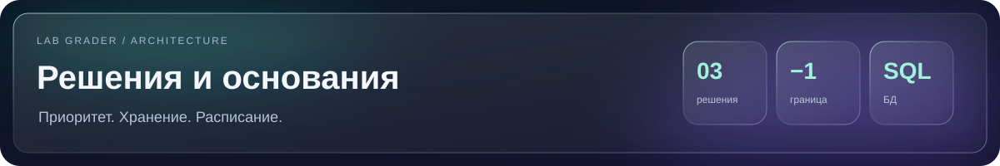

[Главная](../../README.md) · [Навигация по документации](../README.md)

  

# Архитектурные решения

**Что команда выбрала, какие варианты сравнила и на чём основан выбор**

`ADR-0001 / Приоритет` · `ADR-0002 / SQLite` · `ADR-0003 / Расписание`

[Главная](../../README.md) · [Исследование](../../research/queue-study/README.md) · [Реализация](../hackathon/suaios/queue/README.md) · [Запуск](../hackathon/suaios/queue/RUNBOOK.md)

## Три решения

| ADR | Принятое решение | Основание |
|---|---|---|
| **[0001 · Приоритет от −1](0001-priority-policy.md)** | Отдельный класс просроченных работ, устойчивый порядок при равном приоритете, повторная попытка в конце | [Вычислительное исследование](../../research/queue-study/README.md) и выбор команды |
| **[0002 · Состояние в SQLite](0002-sqlite-storage.md)** | Локальная БД, транзакции, ограничения уникальности и журнал событий | Сравнение памяти, JSON, Sheets и внешней СУБД; [структура хранения](../hackathon/suaios/queue/README.md) |
| **[0003 · Расписание и вузы](0003-schedule-adapters.md)** | Адаптеры источников, ручные занятия, перенос с сохранением идентификатора и приоритет ручных правок | Разделение источника расписания, занятия и постоянного участника очереди |

> [!NOTE]
> Команда приняла решения 06.11.2026. Статус ADR фиксирует архитектурный выбор; он не означает подтверждение приёмки организатором.

## Как читать

**Для знакомства с проектом:** сначала [исследование](../../research/queue-study/README.md), затем ADR-0001 и [сценарий работы](../hackathon/suaios/queue/RUNBOOK.md).

**Для разработки:** ADR-0002 и ADR-0003, затем [сущности и операции](../hackathon/suaios/queue/README.md), [API](../hackathon/suaios/queue/API.md) и [состояние реализации](../hackathon/suaios/queue/IMPLEMENTATION_PLAN.md).

**Для проверки результата:** [локальное демо](../hackathon/suaios/queue/SANDBOX.md), [схема и её проверки](../hackathon/suaios/queue/test_schema.py), тесты модулей очереди в `tests/`.

## Связь с кодом

| Решение | Реализация |
|---|---|
| Приоритет | [policy.py](../../grading/defense_queue/policy.py), [operations.py](../../grading/defense_queue/operations.py) |
| Хранение | [storage.py](../../grading/defense_queue/storage.py), [миграции](../../grading/defense_queue/migrations) |
| Расписание | [schedule.py](../../grading/defense_queue/schedule.py), [worker.py](../../grading/defense_queue/worker.py) |

Документы сохраняют аргументацию решений. Текущее подключение API, интерфейсов и фоновых задач описано в [инструкции запуска](../hackathon/suaios/queue/RUNBOOK.md). Термины собраны в [глоссарии](../hackathon/suaios/queue/GLOSSARY.md).

---

[← Главная](../../README.md) · [Исследование и графики](../../research/queue-study/README.md) · [Посмотреть демо](../hackathon/suaios/queue/RUNBOOK.md)

Два обязательных ADR по шаблону задания: [хранение](../hackathon/suaios/ADR-01-storage.md), [расписание](../hackathon/suaios/ADR-02-schedule.md).
