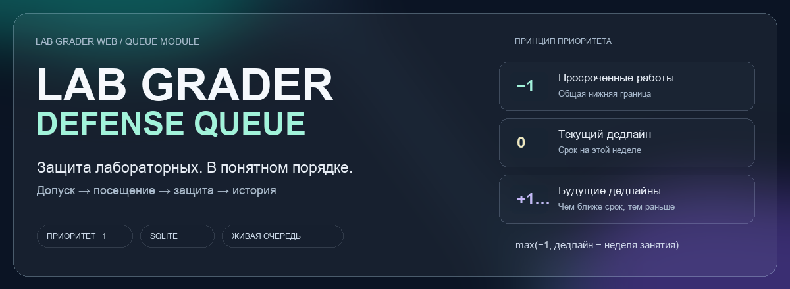

[Главная](../../../README.md) · [Навигация по документации](../../README.md)

# Графика документации

Локальные файлы для главной страницы, исследования, ADR и описания очереди. Они не обращаются к внешним сервисам баннеров и не содержат данных студентов.

| Файл | Назначение |
|---|---|
| `hero.gif` | Обложка главной: плавный четырёхсекундный цикл фоновых переливов, 40 кадров |
| `hero.svg` | Статичная обложка для режима уменьшения движения |
| `hero-preview.png` | Статичный просмотр композиции |
| `checks.svg` | Статичный бейдж подтверждённых локальных проверок; актуальные команды и дата в VERIFICATION.md |
| `stack.svg` | Технологии и нижняя граница приоритета |
| `research.svg` | Обложка исследования |
| `architecture.svg` | Обложка ADR |
| `queue.svg` | Обложка устройства очереди |



Генератор: [render_readme_art.py](../../../scripts/render_readme_art.py).

```bash
uv pip install --python .venv/bin/python pillow
.venv/bin/python scripts/render_readme_art.py
```

Команды выполняются из корня репозитория. Pillow нужен для пересборки графики, приложение от него не зависит. На macOS скрипт использует системный Arial. На другой ОС нужно задать `README_FONT` и `README_FONT_BOLD` путями к TTF-файлам с поддержкой кириллицы.

У GIF общая палитра кадров; меняется фон, а текст и карточки остаются на месте. Главный README использует статичную SVG-обложку; анимация интерфейса находится в отдельном блоке демонстрации. Для него предусмотрен статичный постер при `prefers-reduced-motion: reduce`. В SVG нет скриптов и внешних ресурсов. Содержание статичных и анимированных обложек также продублировано текстом в Markdown.
