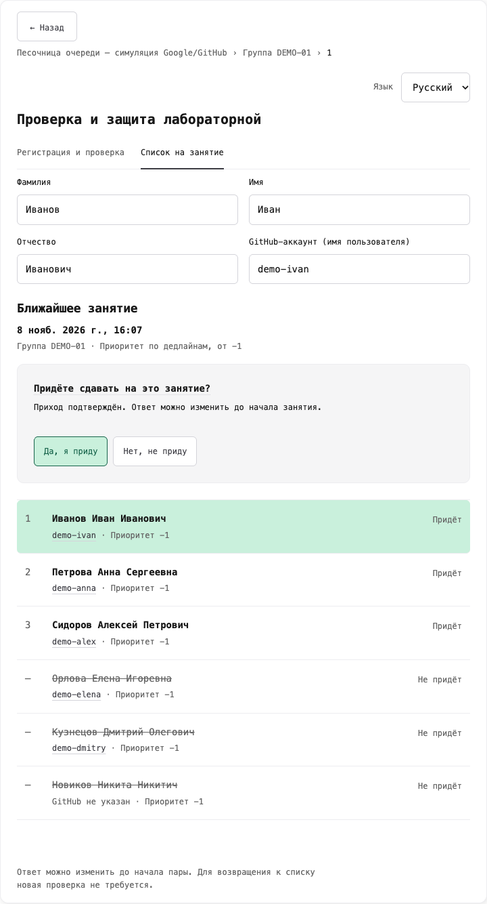
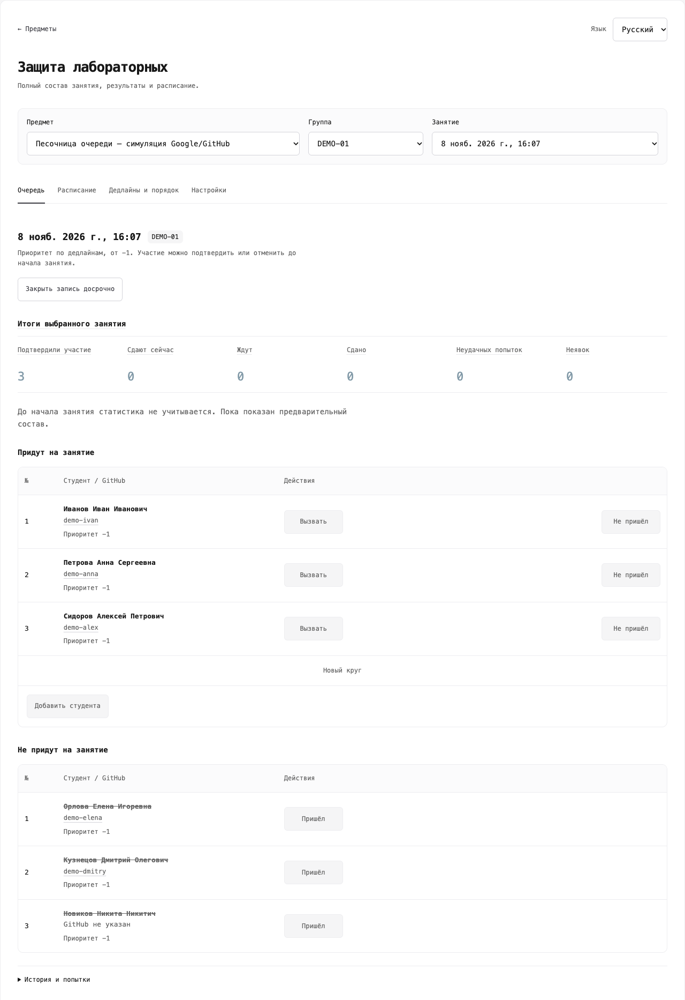
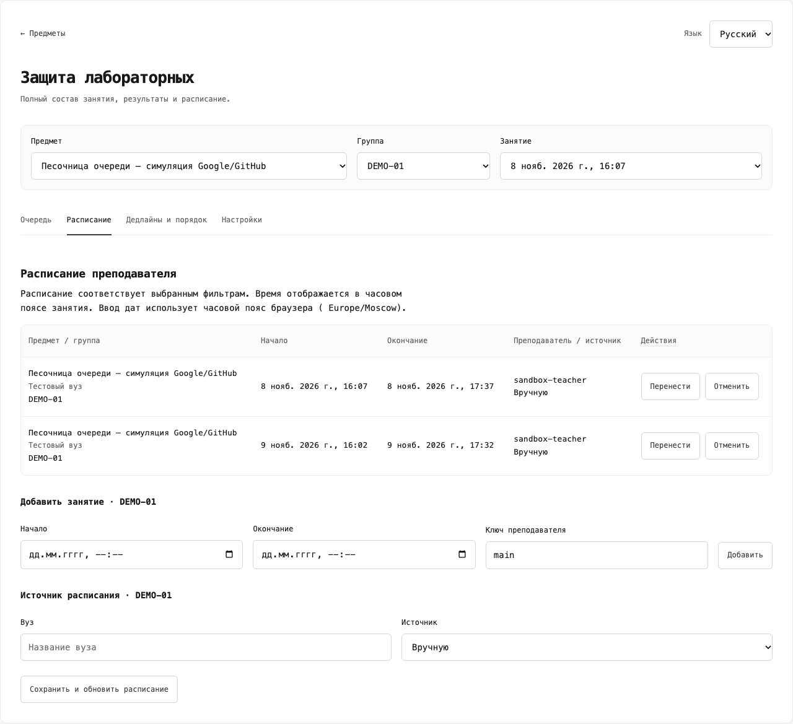

# Снимки интерфейса

[Главная](../../../README.md) · [Документация](../../README.md) · [Песочница](../../hackathon/suaios/queue/SANDBOX.md)

Скрипт снимает настоящий интерфейс песочницы: студента, преподавателя и расписание. Он не сбрасывает данные, не меняет посещение, оценки или занятия. Снимки отражают текущее состояние демонстрации. На рабочем курсе скрипт запускать не нужно.

## Галерея

Снимки получены 08.11.2026 в локальной песочнице и проверены перед включением в README. Все имена и GitHub-аккаунты демонстрационные. Панель преподавателя снята до начала пары: серые действия и неактивная статистика соответствуют этому состоянию.

### Студент



### Преподаватель



### Расписание



## Повторить съёмку

Из корня репозитория запустить песочницу, если она ещё не работает:

```bash
./start-sandbox
```

В другом терминале установить Playwright в игнорируемый каталог и запустить съёмку. Для Chrome не требуется отдельная загрузка Chromium:

```bash
npm install --prefix data/readme-capture --no-save playwright
node scripts/capture_queue_screenshots.cjs --channel chrome
```

Для других портов:

```bash
node scripts/capture_queue_screenshots.cjs --frontend http://localhost:5181 --backend http://localhost:8011 --channel chrome
```

Если Chrome не установлен, загрузить браузер Playwright и выбрать его:

```bash
data/readme-capture/node_modules/.bin/playwright install chromium
node scripts/capture_queue_screenshots.cjs --channel chromium
```

## Результаты

В этом каталоге появятся `student.png`, `teacher.png`, `schedule.png`. Скрипт использует отдельный профиль браузера, размер 1440×1100, русский язык и отключение движения во время кадра. Он снимает область приложения без адресной строки и рабочего стола.

Перед добавлением снимков в главный README нужно открыть все три файла и проверить загрузку данных, отсутствие ошибок, обрезанного текста и реальных персональных данных. Пользователь выполнил полный проход скрипта в браузере. В среде агента запуск локального сервера ограничен (`EPERM`), поэтому повторная съёмка выполняется на компьютере с доступным браузером.
