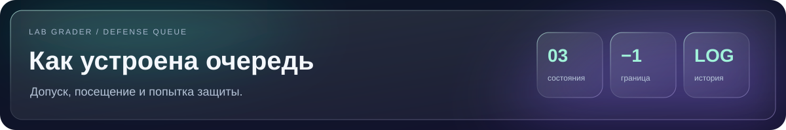
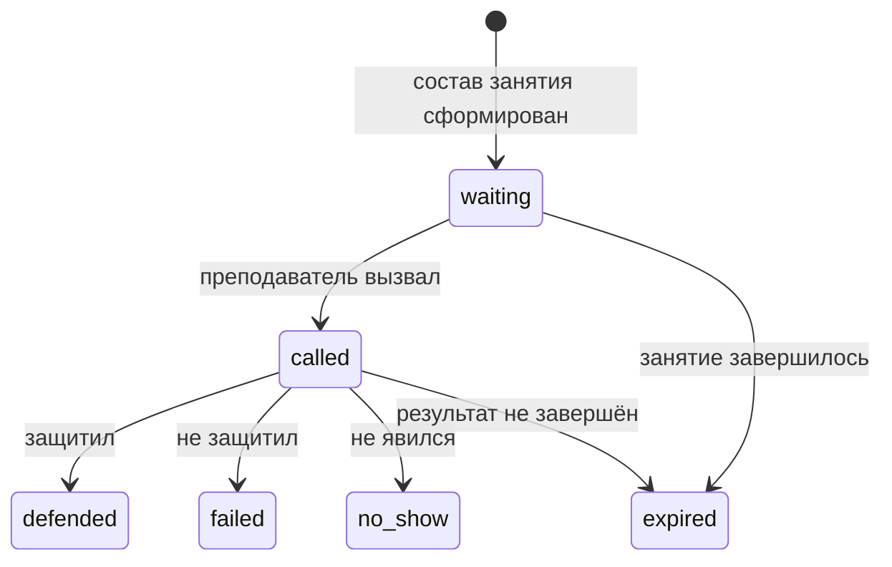

[Главная](../../../../README.md) · [Навигация по документации](../../../README.md)

<p align="center">
  
</p>

<div align="center">

# Очередь защиты лабораторных

**Как сервер формирует состав занятия и сохраняет результаты**

[Демо и запуск](RUNBOOK.md) · [API](API.md) · [Термины](GLOSSARY.md) · [Главная](../../../../README.md)

</div>

> [!TIP]
> Начать знакомство можно с [изолированного демо](SANDBOX.md). Текущая и следующая пары, допуски и участники уже подготовлены.

[SQLite ADR](../../../adr/0002-sqlite-storage.md) · [Алгоритм](../../../adr/0001-priority-policy.md) · [Расписание](../../../adr/0003-schedule-adapters.md) · [Термины](GLOSSARY.md)

Реализация находится в `grading/defense_queue/`, HTTP-маршруты в `main.py`, интерфейсы в `frontend/courses-front/src/components/DefenseQueue/`.

[Запуск и проверка](RUNBOOK.md) · [API и настройки](API.md) · [Состояние работ](IMPLEMENTATION_PLAN.md) · [Проверки и готовность](VERIFICATION.md)

`schema.sql` описывает схему после миграций 001–010. Приложение применяет версионированные миграции из `grading/defense_queue/migrations/`, включая настройки, расписание и задания сверки. Не следует вручную накатывать `schema.sql` поверх базы приложения.

## Постоянная очередь, посещение и попытка

Состав группы, допуск и участие в занятии хранятся отдельно:

1. `queue_candidates`: студент с первой доступной допущенной работой после последней защищённой. Запись создаётся автоматически после проверки и сохраняется между занятиями.
2. `session_participation`: намерение прийти на конкретную пару. По умолчанию участник не придёт и показан зачёркнутым; после «Да» включается в состав, после «Нет» снова зачёркивается. До начала пары можно вернуть ответ «приду».
3. `queue_entries`: попытка защиты в рамках занятия. Её результат остаётся в истории и не перезаписывает постоянную очередь.

`queue_members` содержит всю группу, включая студентов без готовых работ и без GitHub. `session_roster` сохраняет случайный ключ и порядок каждого студента отдельно для каждого занятия.

Целевой работой становится первая допущенная лабораторная после последней защищённой в установленном порядке работ. Пустые, ошибочные и ещё не допущенные ячейки пропускаются. Все работы до последней защищённой больше не влияют на выбор и приоритет: `vv / пусто / v` и `v / vv / v` дают работу 3. Если готовых работ после границы нет, предварительный приоритет считается по следующей после защищённой работе; без защищённых работ — по первой. Предварительное место не является допуском к защите.

В случайном режиме список включает всех студентов группы. В режиме −1 завершившие все работы в новый список не включаются. В обоих режимах на новое занятие все приходят с неподтверждённым участием. При появлении допуска предварительное место сохраняется; подтвердить приход до успешной проверки нельзя. Номер лабораторной в строках списка не отображается.

После окончания занятия сверка через 10 минут подтверждает сданные работы, сохраняя остальных ожидающих. Повторная сверка в 00:00 по часовому поясу занятия закрывает незавершённые попытки; допущенная работа остаётся в постоянном составе. При переносе пары сохраняется `session_id`. Дата меняется как атрибут занятия; сама очередь не зависит от календарной даты.

## Сущности и ключи

| Сущность | Идентификатор | Назначение |
|---|---|---|
| Курс | `course_id` | Часовой пояс, выбранный вуз и режим расписания |
| Группа | `(course_id, group_id)` | Отделяет состав курса от других групп |
| Студент | `student_id` | ФИО, необязательный уникальный GitHub |
| Участие в курсе | `(course_id, student_id)` | Текущая группа и стабильный ключ источника |
| Состав группы | `(course_id, group_id, student_id)` | Готовая или следующая работа, предварительный срок и признак завершения |
| Место в списке | `(session_id, student_id)` | Сохранённый случайный ключ и порядок |
| Постоянный участник | `candidate_id` | Допущенная работа, срок и время появления в очереди |
| Занятие | `session_id` | Группа, преподаватель, источник и изменяемые время/дата |
| Посещение | `(session_id, candidate_id)` | Приду / не приду, время изменения и фиксации |
| Ручная правка расписания | `session_id`, `schedule_revision` | Перенос/отмена в занятии и событие в журнале; таблица `schedule_overrides` зарезервирована исходной схемой |
| Попытка | `entry_id` | Работа, приоритет, результат и снимок допуска |
| Событие | `event_id` | Автор, время и причина изменения; только добавление |

Номер строки Google Sheets не является постоянным идентификатором студента. Принадлежность группе и порядок обязательных работ проверяются сервисом при автоматическом добавлении. Неоднозначное совпадение ФИО требует уточнения; выбор первого совпадения не допускается.

## Фиксация посещения

До начала пары допустимы переходы `will_attend: 1 → 0` и `0 → 1`. При начале пары сервер фиксирует состав через `frozen_at`. Триггер запрещает изменение намерения после фиксации. Сервер дополнительно проверяет текущее время в транзакции, чтобы позднее выполнение фонового таймера не оставило окно для изменения.

Во время пары и 10 минут после окончания студент видит текущие списки без кнопок; подтверждение следующего занятия открывается после этой границы. Преподаватель продолжает вызывать, отмечать результат и неявку. Повторная попытка уже присутствующего участника добавляется в конец текущего состава как продолжение приёма.

При переносе ещё не состоявшегося занятия сервер обновляет его интервал и сохраняет идентификатор, участников и намерения. Если состав успел зафиксироваться, административный перенос с новой будущей датой открывает его для изменения отдельной операцией с событием в истории. Обычный студент не может снять фиксацию.

## Статусы попытки



Закрытая попытка сохраняется. Новый подход создаёт новую строку. Статус `withdrawn` оставлен для административного закрытия попытки с причиной; студенческий ответ «не приду» хранится в намерении посещения и не заменяет результат попытки.

## Атомарные операции

| Операция | Проверки | Изменения одной транзакцией |
|---|---|---|
| Добавить после проверки | Первая доступная работа после последней защищённой допущена, группа и студент сопоставлены | Постоянный участник + событие |
| Изменить посещение | Свой участник, занятие ещё не началось | Намерение + событие |
| Зафиксировать состав | Начало пары наступило | Фиксация посещений, создание попыток для приходящих + события |
| Вызвать | У преподавателя нет вызванного, кандидат ожидает | `called`, время, версия + событие |
| Результат | Право преподавателя, текущая незавершённая попытка | Терминальный результат + событие; обновление постоянного участника при успешной защите |
| Перенести | Право преподавателя, допустимый интервал | Время того же занятия и ручное исключение + событие |
| Завершить занятие | Окончание наступило | Закрытие попыток, сохранение постоянных участников + события |

Внешние API вызываются до SQL-транзакции. При фиксации повторно проверяются время и состояния. Одинаковый `request_key` служебной операции не создаёт вторую попытку при повторной доставке запроса.

## Пересекающиеся занятия

Группы G1 и G2 могут иметь пары в одно время с отдельными списками. Преподаватель может вызвать нескольких студентов и завершить каждую защиту отдельно. Другие преподаватели работают параллельно. Одновременно у студента может быть одна активная попытка курса и одна текущая допущенная работа в постоянной очереди.

Ручная отмена одной пары не отменяет дополнительную пару того же дня. Перенос сохраняет идентификатор занятия. При отмене без замены постоянные участники обслуживаются на следующем доступном занятии своей группы и предмета.

## Оценки и история

Оценки принадлежат существующему процессу проверки и преподавателю. Снимок допуска объясняет причину включения в очередь, но не становится отдельным официальным журналом баллов. `queue_events` может ссылаться на участника без занятия: это необходимо для автоматического появления после тестов, когда дата следующей пары ещё не известна.

## Проверка

```bash
python3 docs/hackathon/suaios/queue/test_schema.py
```

Тесты используют временные SQLite-базы. Проверяются перезапуск, одновременная запись, отсутствие дублей, несколько одновременных защит с независимыми результатами, посещение в обе стороны до фиксации, запрет после фиксации, сохранение состава при переносе, постоянный участник после завершения попытки и история допуска до назначения занятия.

Эта команда проверяет ограничения исходной схемы. Модули приложения, HTTP-контракт и сценарии интерфейса проверяются отдельно; команды и границы проверок приведены в [инструкции](VERIFICATION.md).

---

[← Главная](../../../../README.md) · [Демо и запуск](RUNBOOK.md) · [Архитектурные решения](../../../adr/README.md) · [Исследование](../../../../research/queue-study/README.md)

## Изменения по ревью PR #67

[Дневная очередь — D1](REVIEW-D1.md) · [FIFO и окно записи — D2/D3/D6](REVIEW-D2.md) · [Локальные результаты во время пары — D5](REVIEW-D5.md). Описанные выше фиксация в начале пары и предварительный порядок относятся к прежним моделям; FIFO допускает запись до конца пары. Во время обычной пары внешняя таблица модулем очереди не перечитывается.
