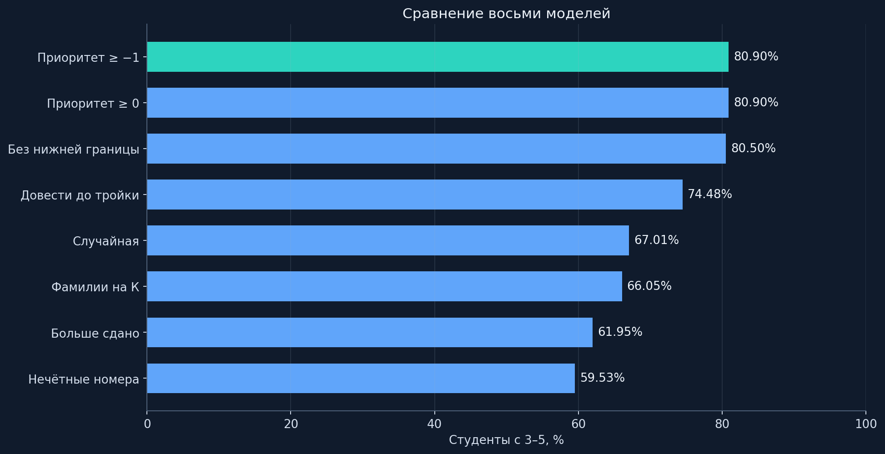
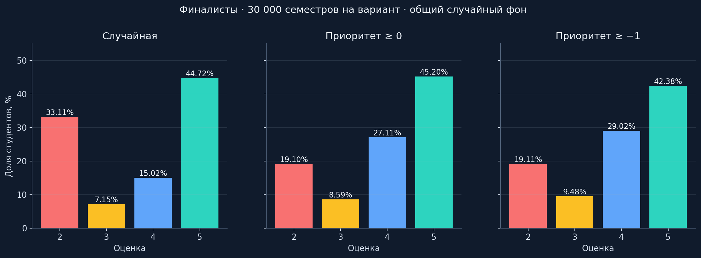
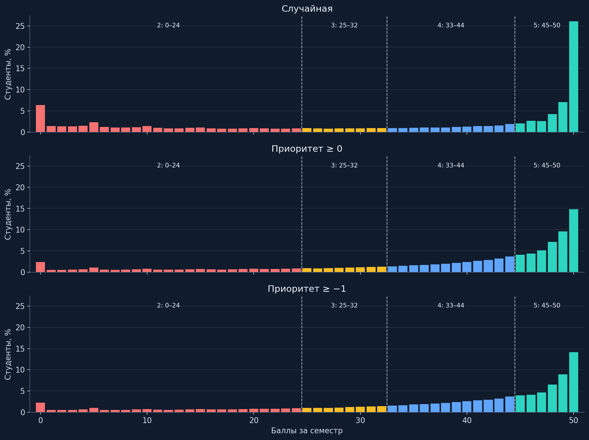
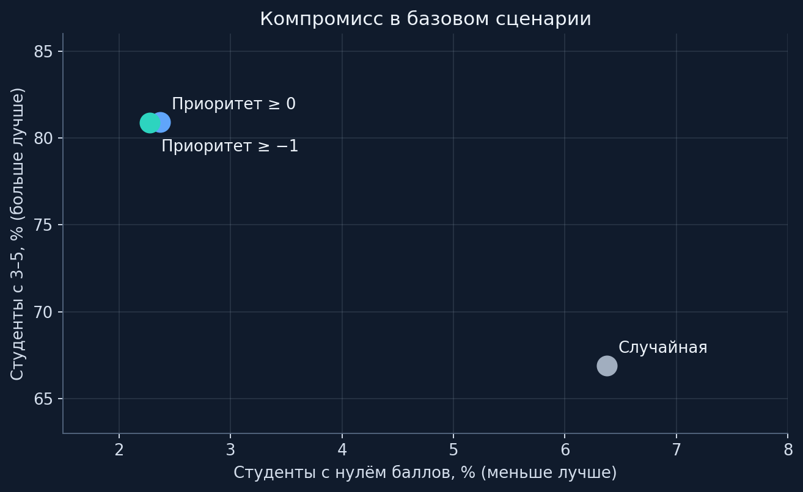
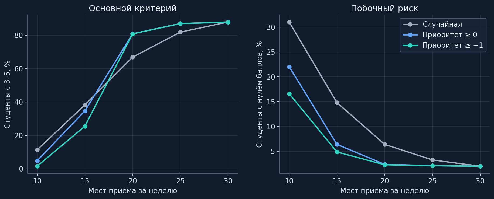
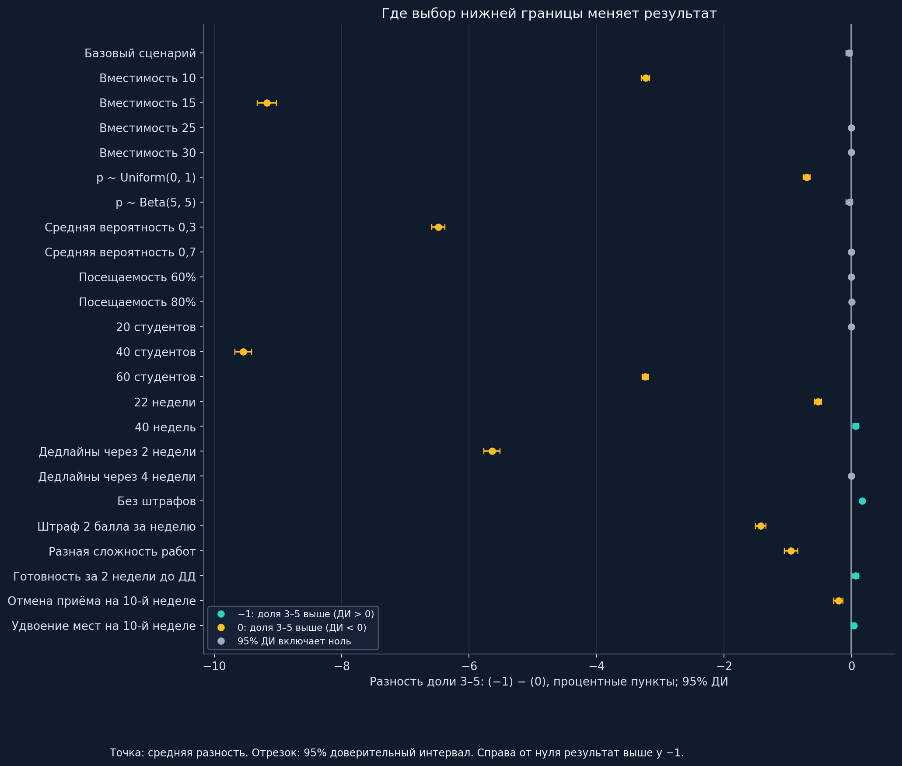
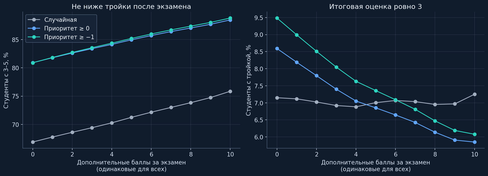

[Главная](../../README.md) · [Навигация по документации](../../docs/README.md)

<p align="center">
  
</p>

<div align="center">

# Очередь с приоритетом −1

**Сравнение алгоритмов приёма лабораторных и обоснование выбранной модели**

`30 студентов` · `10 работ` · `30 недель` · `20 мест` · `10 000 прогонов`

[Все модели](#сравнение-восьми-моделей) · [Финалисты](#три-финалиста) · [Экзамен](#что-меняется-после-экзамена) · [ADR](../../docs/adr/README.md)

[Главная](../../README.md) · [Запустить приложение](../../docs/hackathon/suaios/queue/RUNBOOK.md) · [Исходные результаты](results)

</div>

> **Выбрана приоритетная очередь с нижней границей −1.** Среди трёх финалистов она даёт наименьшую долю нулевых результатов в базовом сценарии, сохраняет около 80,9% оценок 3–5 и отделяет просроченные работы от текущего дедлайна. При добавлении пяти экзаменационных баллов доля студентов с оценкой не ниже 3 оказывается выше, чем у границы 0.

## Задача и критерий

На занятии преподаватель успевает принять ограниченное число лабораторных. Порядок влияет на то, кто попадёт на приём до дедлайна и сколько баллов потеряет при задержке. При одинаковой вместимости сравнивается распределение возможностей сдачи; пропуск из-за очереди не считается успешной защитой и не открывает следующую работу.

Основной показатель: **доля студентов с итоговыми оценками 3, 4 или 5**, то есть с 25–50 баллами. Дополнительные критерии выбора: доля нулевых результатов, распределение баллов до экзамена и после него, прозрачность приоритетов. Отдельно рассматриваются завершённые работы и пропуски из-за очереди.

Расчёты выполнены на синтетических студентах. Баллы относятся к симуляции; в приложении очередь организует приём лабораторных, а оценки остаются в существующем процессе преподавателя и Google Sheets.

## Набор моделей

Исходники моделей и расчётного стенда находятся в [source/](source). Для воспроизведения доступны [контрольные суммы файлов](original_source_hashes.json), параметры и сырые баллы.

| Модель | Правило |
|---|---|
| `random` | Случайный порядок активных студентов каждую неделю |
| `priority` | Меньше `deadline − week` → раньше |
| `priority_clamped` | `max(−1, deadline − week)`; равные приоритеты случайны |
| `priority_clamped_zero` | Отдельный класс: `max(0, deadline − week)`; равные приоритеты случайны |
| `most_passed` | Больше завершённых работ → раньше |
| `target_three` | Сначала ближе к 25 баллам; после достижения порога студент больше не получает попытки |
| `surname_k` | Сначала условные фамилии на «К», внутри класса случайно |
| `odd_number` | Сначала нечётные номера студентов, внутри класса случайно |

Модель `target_three` является эвристикой максимизации числа троек: ресурс освобождается после получения 25 баллов. Она ограничивает дальнейший набор баллов и поэтому не включена в финалисты, хотя позволяет проверить эффект отдельного целевого порога. Глобальная математическая оптимальность такого правила не предполагается.

Два произвольных правила добавлены для контроля: буква фамилии и чётность номера не связаны со сроком работы. В модели «К» привилегия назначена синтетическим индексам 0, 10, 20 из 30; реальные фамилии не нужны. В модели нечётных номеров нумерация начинается с 1. Их результаты учитываются в общей таблице, а в финале сравниваются случайная очередь и две границы приоритета.

## Базовый сценарий

**Базовый сценарий** — общие условия, относительно которых меняется один параметр при анализе чувствительности. Он описывает группу из 30 студентов, 10 лабораторных и семестр из 30 недель с одним приёмом в неделю на 20 человек. Все студенты с незавершённой текущей работой хотят сдавать и присутствуют; вероятность успешной защиты фиксируется для каждого студента на весь семестр.

| Параметр | Базовое значение |
|---|---|
| Размер группы / число работ | 30 / 10 |
| Период | 30 недель, один приём в неделю |
| Вместимость | **20** человек; 15 проверяется отдельно как жёсткий сценарий |
| Вероятность сдачи | `clip(Normal(0.5, 0.15), 0.05, 0.95)` |
| Дедлайн работы k | `3k − 1`: недели 2, 5, 8, …, 29 |
| Баллы за работу | `max(0, 5 − max(0, неделя_защиты − дедлайн))` |
| Последовательность | Следующая работа доступна после защиты предыдущей |
| Попытки | Не больше одной за неделю; при нехватке мест защита переносится |
| Готовность | Текущая работа доступна с первой недели; подготовка отдельно проверяется в чувствительности |
| Оценки | 2: 0–24; 3: 25–32; 4: 33–44; 5: 45–50 |

Максимальная сумма за десять работ составляет 50 баллов. В неделю дедлайна штрафа нет. Работа с нулевой стоимостью всё ещё должна быть защищена, чтобы открылась следующая. Экзаменационные баллы добавляются отдельным расчётом и не меняют историю баллов за лабораторные.

## Методика

**Общее сравнение:** восемь моделей по 10 000 семестров, всего 80 000 симуляций. Начальные seed: 42…10041. Для каждой модели сохранены графики, баллы и статистика каждого семестра. При одинаковых seed исходы конкретного студента могут разойтись между моделями из-за различного порядка обращений к генератору.

**Три финалиста:** 24 сценария по 10 000 семестров на вариант. Базовый сценарий дополнительно повторён с seed 1042 и 2042. Всего 780 000 симуляций. Для трёх алгоритмов совпадают начальные вероятности, посещаемость, случайные ключи равных приоритетов и исходы возможных попыток каждого студента на каждой неделе. Меняется только доступ к приёму. Векторный расчёт проверен независимой реализацией с циклами.

Разность показателей рассчитывается внутри одного семестра, затем усредняется. 95% доверительный интервал: `mean(delta) ± 1.96 × std(delta, ddof=1) / sqrt(n_runs)`. Независимое наблюдение — семестр: студенты одной группы конкурируют за общий ресурс. Интервал показывает ошибку Монте-Карло при заданных допущениях. Для сценариев чувствительности интервалы описательные, без поправки на множественные сравнения.

## Сравнение восьми моделей



| Алгоритм | Оценки 3–5 | Ноль баллов | Средний балл |
|---|---:|---:|---:|
| Приоритет ≥ −1 | 80.90% | 2.31% | 36.87 |
| Приоритет ≥ 0 | 80.90% | 2.37% | 37.19 |
| Без нижней границы | 80.50% | 2.26% | 36.62 |
| Довести до тройки | 74.48% | 9.45% | 21.38 |
| Случайная | 67.01% | 6.38% | 32.83 |
| Фамилии на К | 66.05% | 6.78% | 32.47 |
| Больше сдано | 61.95% | 23.91% | 31.06 |
| Нечётные номера | 59.53% | 11.27% | 30.02 |

Приоритет с ограничением снизу даёт высокий охват положительными оценками без преимущества за каждую дополнительную неделю старого долга. У модели «больше сдано» высокий средний результат части студентов сочетается с большой долей нулей. Вариант «довести до тройки» сохраняет достигших порога внутри диапазона оценки 3 ценой отказа от дальнейшего учебного прогресса. Произвольные привилегии по фамилии или номеру не дают аргумента для практического применения.

## Три финалиста

Для базового сценария объединены три seed по 10 000 семестров: **900 000 синтетических студентов на алгоритм**. Результаты этого этапа рассматриваются отдельно от общего сравнения.



| Алгоритм | Оценки 3–5 | Ноль баллов | Среднее | Медиана всех баллов | СКО всех баллов |
|---|---:|---:|---:|---:|---:|
| «Случайная» | 66.89% | 6.38% | 32.800 | 41.0 | 18.331 |
| «Приоритет ≥ 0» | 80.90% | 2.37% | 37.197 | 43.0 | 14.378 |
| «Приоритет ≥ −1» | 80.89% | 2.27% | 36.872 | 42.0 | 14.180 |

Обе ограниченные очереди дают около 80,9% оценок 3–5. Разница между ними по этому показателю мала; преимущество выбранной границы −1 состоит в меньшей доле нулевых результатов и отдельном классе просроченных работ. Для оценки распределения ниже показаны все баллы с цветами и границами автоматов.



Ноль баллов означает нулевой итог за лабораторные. Он возможен и после неудачных попыток, и после защиты работ, уже потерявших стоимость. Показатель «не было ни одной принятой попытки» сохранён отдельно как `never_served_share`; в базовом сравнении финалистов он равен нулю у всех трёх алгоритмов. Поэтому снижение нулевых баллов означает улучшение итогового результата, а не доказанное увеличение числа впервые принятых студентов.

### Насколько велика разница

В таблице из результата модели «Приоритет ≥ −1» вычитается результат указанной модели сравнения. Например, **−0,095 процентного пункта по нулям** означает меньше студентов с нулём баллов у −1; **+0,3 пункта по оценкам 3–5** означало бы больше студентов с положительной итоговой оценкой у −1. Для среднего балла положительная разность означает более высокий средний результат.

| Сравнение | Показатель | Разность | 95% ДИ |
|---|---|---:|---:|
| «Приоритет ≥ −1» против «Случайная» | Доля 3–5, п. п. | +13.997 | [+13.914; +14.080] |
| «Приоритет ≥ −1» против «Случайная» | Нули, п. п. | -4.101 | [-4.141; -4.060] |
| «Приоритет ≥ −1» против «Случайная» | Средние баллы | +4.072 | [+4.039; +4.105] |
| «Приоритет ≥ −1» против «Приоритет ≥ 0» | Доля 3–5, п. п. | -0.015 | [-0.043; +0.013] |
| «Приоритет ≥ −1» против «Приоритет ≥ 0» | Нули, п. п. | -0.095 | [-0.103; -0.088] |
| «Приоритет ≥ −1» против «Приоритет ≥ 0» | Средние баллы | -0.325 | [-0.334; -0.316] |

Для доли 3–5 базовый интервал разности между двумя приоритетными моделями включает ноль. По нулевым баллам у −1 наблюдается устойчивое снижение относительно 0. Полные расчёты доступны в [paired_comparisons.csv](results/finalists/paired_comparisons.csv).



### Два способа считать статистику

В таблице финалистов медиана и СКО рассчитаны по объединённым баллам. Ниже показатели сначала вычисляются внутри группы, затем усредняются между семестрами. СКО популяционное (`ddof=0`). При одинаковом размере групп средние баллы совпадают; средние медиан и СКО совпадать не обязаны.

| Алгоритм | Среднее средних | Среднее медиан | Среднее СКО | Работ на студента | Макс. подряд пропусков в группе, среднее | Отказы / желаемые попытки |
|---|---:|---:|---:|---:|---:|---:|
| «Случайная» | 32.800 | 39.807 | 17.941 | 8.955 | 5.218 | 26.07% |
| «Приоритет ≥ 0» | 37.197 | 42.355 | 13.348 | 9.174 | 4.656 | 31.82% |
| «Приоритет ≥ −1» | 36.872 | 41.858 | 12.974 | 9.167 | 4.745 | 31.93% |

Пропуск означает присутствие студента с доступной работой без получения места. Счётчик подряд обнуляется при обслуживании, отсутствии или недоступности работы. Алгоритмы меняют число активных студентов и знаменатель доли отказов, поэтому по одной этой метрике лучшего алгоритма не выбрать.

## Когда меняются условия

В каждой строке изменён один фактор относительно базового сценария. Seed 42, по 10 000 семестров на алгоритм. При разной сложности множитель вероятности сдачи растёт от 0,8 для первой работы до 1,2 для десятой; итоговая вероятность ограничена диапазоном [0, 1]. В сценарии готовности работа доступна не раньше `max(1, deadline − 2)`.

| Условие | «Случайная»: 3–5 | «Приоритет ≥ 0»: 3–5 | «Приоритет ≥ −1»: 3–5 | Разность −1 и 0, п. п. |
|---|---:|---:|---:|---:|
| Базовый сценарий | 66.86% | 80.87% | 80.84% | -0.037 |
| Вместимость 10 | 11.37% | 4.80% | 1.57% | -3.233 |
| Вместимость 15 | 38.26% | 34.70% | 25.53% | -9.173 |
| Вместимость 25 | 81.86% | 86.99% | 86.99% | +0.000 |
| Вместимость 30 | 87.92% | 87.92% | 87.92% | +0.000 |
| p ~ Uniform(0, 1) | 59.77% | 65.09% | 64.39% | -0.702 |
| p ~ Beta(5, 5) | 66.48% | 80.20% | 80.16% | -0.033 |
| Средняя вероятность 0,3 | 25.68% | 19.08% | 12.59% | -6.485 |
| Средняя вероятность 0,7 | 93.87% | 98.57% | 98.57% | +0.000 |
| Посещаемость 60% | 51.45% | 52.45% | 52.45% | -0.001 |
| Посещаемость 80% | 64.76% | 72.98% | 72.99% | +0.002 |
| 20 студентов | 87.82% | 87.82% | 87.82% | +0.000 |
| 40 студентов | 38.21% | 34.59% | 25.04% | -9.548 |
| 60 студентов | 11.27% | 4.75% | 1.51% | -3.237 |
| 22 недели | 58.43% | 73.28% | 72.76% | -0.525 |
| 40 недель | 67.30% | 81.48% | 81.55% | +0.067 |
| Дедлайны через 2 недели | 30.39% | 29.50% | 23.86% | -5.642 |
| Дедлайны через 4 недели | 82.01% | 92.19% | 92.19% | +0.000 |
| Без штрафов | 95.27% | 97.50% | 97.67% | +0.170 |
| Штраф 2 балла за неделю | 60.38% | 73.39% | 71.96% | -1.425 |
| Разная сложность работ | 58.78% | 70.26% | 69.31% | -0.948 |
| Готовность за 2 недели до ДД | 74.57% | 79.55% | 79.62% | +0.064 |
| Отмена приёма на 10-й неделе | 62.54% | 75.80% | 75.59% | -0.205 |
| Удвоение мест на 10-й неделе | 68.90% | 82.34% | 82.38% | +0.035 |



При снижении вместимости уменьшается ресурс для устранения задолженности и меняется относительная польза очередей. Различия сценариев отражены в таблице; вывод для базы относится к вместимости 20. При вместимости на всю группу результаты трёх правил совпадают побитно, поскольку порядок перестаёт ограничивать доступ.



На графике точка обозначает среднюю разность доли 3–5, отрезок — 95% доверительный интервал. Справа от нулевой линии результат выше у «Приоритет ≥ −1», слева — у «Приоритет ≥ 0». Зелёный цвет означает интервал целиком выше нуля, оранжевый — ниже, серый — интервал включает ноль. Серая точка означает, что направление различия в этом опыте не установлено с выбранной точностью.

## Что меняется после экзамена

Для проверки распределения перед экзаменом рассчитаны дополнительные сценарии: к каждому результату добавляется одинаковое число баллов, итог ограничивается 50. Это допущение о результате экзамена, а не измеренные экзаменационные оценки. Показатель «не ниже 3» включает тройки, четвёрки и пятёрки; доля ровно троек сохранена отдельно.

| Дополнительные баллы | «Случайная»: 3–5 | «Приоритет ≥ 0»: 3–5 | «Приоритет ≥ −1»: 3–5 | Разность −1 и 0, п. п. |
|---|---:|---:|---:|---:|
| +0 | 66.89% | 80.90% | 80.89% | -0.015 |
| +1 | 67.77% | 81.78% | 81.83% | +0.045 |
| +3 | 69.42% | 83.38% | 83.55% | +0.163 |
| +5 | 71.25% | 84.95% | 85.19% | +0.243 |
| +10 | 75.86% | 88.46% | 88.79% | +0.332 |



При одинаковых **+5 баллах** у −1 больше студентов переходят порог положительной оценки, чем у 0. В распределении −1 оказывается больше результатов в области, из которой этих пяти баллов достаточно для выхода на тройку. Это дополнительный аргумент в пользу распределения выбранной модели: важен не только уже полученный автомат, но и возможность добрать до положительной оценки на экзамене.

| Экзаменационные баллы | Преимущество −1 по доле 3–5, п. п. | 95% ДИ |
|---|---:|---:|
| +0 | -0.015 | [-0.043; +0.013] |
| +1 | +0.045 | [+0.018; +0.071] |
| +3 | +0.163 | [+0.138; +0.188] |
| +5 | +0.243 | [+0.220; +0.266] |
| +10 | +0.332 | [+0.313; +0.351] |

Преимущество зависит от количества и распределения экзаменационных баллов. Для приведённых интервалов использовано парное сравнение семестров; [exam_scenarios.csv](results/finalists/exam_scenarios.csv) содержит все значения от +0 до +10, включая долю ровно троек и новых переходов через 25 баллов.

## Почему выбрана граница −1

Правило: **`priority = max(−1, deadline_week − current_week)`**, меньшее значение обслуживается раньше. Сильно просроченные работы не накапливают бесконечное преимущество: просрочка и на одну, и на десять недель даёт −1. Текущий дедлайн имеет 0; будущие сроки дают положительные значения без верхней границы.

Выбор опирается на три свойства:

- **Меньше нулевых результатов среди финалистов в базовом сценарии.** При практически одинаковой доле 3–5 у границ 0 и −1 выбранная модель уменьшает долю студентов с нулём баллов.
- **Прозрачное разделение сроков.** Просроченные работы составляют отдельный класс −1; работы текущего дедлайна — класс 0. Возраст долга внутри отрицательного класса не даёт дополнительных привилегий.
- **Потенциал добора на экзамене.** В сценарии +5 баллов распределение −1 даёт больше положительных итоговых оценок и более высокий охват порога 25 баллов.

### Цена решения

Граница −1 поддерживает задолженность за счёт части ресурса текущих и будущих сроков. Это отражается в среднем балле и распределении высоких оценок. При выборе учитывается совокупность критериев: охват оценками 3–5, сокращение нулевых результатов и понятный порядок обслуживания. Результаты чувствительности позволяют оценить эту политику при другой нагрузке. Решение зафиксировано в [ADR-0001](../../docs/adr/0001-priority-policy.md).

## Область применения расчётов

Симулятор использует недельный шаг и одну попытку на студента в неделю. Продолжительность защиты, опоздания внутри пары, изменение подготовки в течение семестра, стратегия выбора посещения, несколько преподавателей и реальные данные расписания в расчёт не включены. Посещаемость и готовность проверены отдельными сценариями.

В приложении студент после допуска появляется в постоянном списке. Намерение прийти на конкретное занятие можно изменить до его начала; отказ отображается зачёркиванием. В недельной модели этот выбор приближён вероятностью посещения. Стабильный порядок равных приоритетов и повторная сдача в конце текущего занятия относятся к продуктовым правилам, описанным в ADR.

В симуляции штраф зависит от недели защиты. В существующем сервисе штраф за проверку фиксируется при прохождении тестов и может отличаться от текущего возраста долга. Приоритет проектируемой очереди определяется дедлайном и учебной неделей занятия; оценки из таблицы только читаются.

## Данные и графики

| Модель | Графики | Результаты |
|---|---|---|
| Больше сдано | [Баллы](results/original/most_passed/histogram.png) · [Оценки](results/original/most_passed/automat_bars.png) · [Нули отдельно](results/original/most_passed/automat_bars_with_zero.png) | [Данные](results/original/most_passed) |
| Нечётные номера | [Баллы](results/original/odd_number/histogram.png) · [Оценки](results/original/odd_number/automat_bars.png) · [Нули отдельно](results/original/odd_number/automat_bars_with_zero.png) | [Данные](results/original/odd_number) |
| Без нижней границы | [Баллы](results/original/priority/histogram.png) · [Оценки](results/original/priority/automat_bars.png) · [Нули отдельно](results/original/priority/automat_bars_with_zero.png) | [Данные](results/original/priority) |
| Приоритет ≥ −1 | [Баллы](results/original/priority_clamped/histogram.png) · [Оценки](results/original/priority_clamped/automat_bars.png) · [Нули отдельно](results/original/priority_clamped/automat_bars_with_zero.png) | [Данные](results/original/priority_clamped) |
| Приоритет ≥ 0 | [Баллы](results/original/priority_clamped_zero/histogram.png) · [Оценки](results/original/priority_clamped_zero/automat_bars.png) · [Нули отдельно](results/original/priority_clamped_zero/automat_bars_with_zero.png) | [Данные](results/original/priority_clamped_zero) |
| Случайная | [Баллы](results/original/random/histogram.png) · [Оценки](results/original/random/automat_bars.png) · [Нули отдельно](results/original/random/automat_bars_with_zero.png) | [Данные](results/original/random) |
| Фамилии на К | [Баллы](results/original/surname_k/histogram.png) · [Оценки](results/original/surname_k/automat_bars.png) · [Нули отдельно](results/original/surname_k/automat_bars_with_zero.png) | [Данные](results/original/surname_k) |
| Довести до тройки | [Баллы](results/original/target_three/histogram.png) · [Оценки](results/original/target_three/automat_bars.png) · [Нули отдельно](results/original/target_three/automat_bars_with_zero.png) | [Данные](results/original/target_three) |

| Файл | Содержимое |
|---|---|
| `results/original/<model>/all_scores.npy` | 300 000 баллов: прогон, затем студент |
| `results/original/<model>/score_distribution.csv` | Распределение 0…50 |
| `results/original/<model>/per_run_stats.csv` | Среднее, медиана, СКО каждого семестра |
| `results/original/comparison.csv` | Общая таблица восьми моделей |
| `results/finalists/summary.csv` | Сценарии и показатели финалистов |
| `results/finalists/<scenario>/<seed>/*_scores.npz` | Массив `[прогон, студент]`, ключ `scores` |
| `results/finalists/<scenario>/<seed>/*_runs.csv.gz` | Статистика каждого семестра |
| `results/finalists/<scenario>/<seed>/*_histogram.csv` | Все 51 значение баллов |
| `results/finalists/<scenario>/<seed>/summary.json` | Параметры и агрегаты |
| `results/finalists/protocol.json` | Параметры расчётов и версии среды |
| `figures/*.png`, `figures/*.svg` | Изображения для GitHub и презентации |

## Воспроизведение

Из корня репозитория, Python 3.12:

```bash
python3.12 -m venv .venv-research
source .venv-research/bin/activate
pip install -r research/queue-study/requirements.txt
python research/queue-study/test_study.py
python docs/hackathon/suaios/queue/test_schema.py
python research/queue-study/reproduce.py --runs 10000 --seed 42
python research/queue-study/study.py --runs 10000 --seeds 42 1042 2042
python research/queue-study/report.py
python research/queue-study/validate_results.py
```

Для перестроения статьи и графиков по сохранённым данным достаточно `report.py`. Текст находится в [article.md.in](article.md.in), параметры финалистов — в [study.py](study.py), общих моделей — в [common.py](source/common.py). Отдельный запуск границы 0: `python research/queue-study/source/main.py priority_clamped_zero --runs 10000`.

Результаты проверок доступны в [validation.json](validation.json), контрольные суммы артефактов — в [artifact_hashes.json](artifact_hashes.json).
